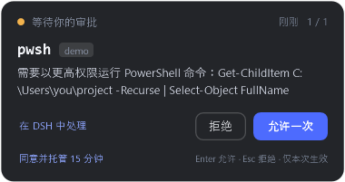

# 审批浮窗 · dsh-approval-hud

把 DeepSeek Harness 的权限审批从主窗口搬到一个**始终置顶的小卡片**里。你在浏览器、编辑器或别的应用里工作时，审批请求会出现在屏幕角落；点“允许一次”或“拒绝”，agent 立刻继续，不需要切回 DSH。



## 它解决什么

DSH 默认把审批卡片放在对话输入框上方。窗口切走之后，agent 会一直停在那里等你，而你往往看不到。

这个插件在**宿主侧**接管 `approval/request` 事件，用一个独立的 Windows 窗口显示审批：

- 卡片始终置顶，但**不抢焦点**，可以继续在别的窗口打字。
- 显示工具名、项目名、审批理由、已等待时间和队列位置。
- **允许一次** / **拒绝** / **在 DSH 中处理**。
- 托盘常驻盾牌图标；窗口不会自动消失，直到你处理。
- 同一个会话、不同会话、子任务的审批统一排队。
- 浮窗不可用时，审批自动回到 DSH 原生面板；**绝不会自动放行**。

## 要求

| 项目 | 要求 |
|---|---|
| 系统 | Windows 10 / 11 |
| DSH | `0.2.1-rc.1` 或更新（桌面版或自带 Web 宿主） |
| PowerShell | 系统自带的 Windows PowerShell 5.1 |
| 其他 | 不需要 Node、不需要构建、不需要管理员权限 |

## 安装

安装后必须**重启 DSH 进程**（桌面版没有 HMR）；只刷新网页不够。

### 方式 A：插件管理器

1. 保留 `dsh-approval-hud` 文件夹，或已经打好的 `dsh-approval-hud-0.2.0.tgz`。
2. 打开 DSH 的**插件**页面（侧边栏 → 插件，或设置 → 插件）。
3. 添加插件，填绝对路径：
   - 文件夹：`link:C:\你的路径\dsh-approval-hud`
   - 安装包：`file:C:\你的路径\dsh-approval-hud-0.2.0.tgz`
4. 重启 DSH。
5. 托盘出现盾牌图标，表示浮窗进程已启动。

> 如果插件管理器不接受本地路径，用方式 B。

### 方式 B：install.ps1（推荐，最稳）

1. 从托盘菜单**完全退出 DSH**。
2. 在 PowerShell 中运行：

   ```powershell
   powershell -ExecutionPolicy Bypass -File .\install.ps1
   ```

   脚本会把插件复制到 `%USERPROFILE%\.dsh\plugins\`，写入 `desktop` profile 的依赖和 bundle 列表，并用 DSH 自带的 pnpm 安装。
3. 重新打开 DSH。

常用参数：

```powershell
.\install.ps1 -DryRun          # 只打印计划，不修改任何文件
.\install.ps1 -Profile web     # 装到 web profile
.\install.ps1 -Uninstall       # 卸载
```

### 方式 C：命令行

```powershell
dsh plugin --profile desktop add "link:C:\你的路径\dsh-approval-hud"
```

然后重启 DSH。

> 装好后在 DSH 的**插件页**里显示为 **审批浮窗**（包名 `dsh-approval-hud`，条目 id `approval-hud`）。
> 页面还是旧列表时按 `Ctrl+R` 刷新；`设置 → 插件` 的只读清单只显示**已加载**条目，需要重启 DSH 后才会出现。
> 插件页只负责管理/显示；浮窗真正加载要等下一次 DSH 启动。

## 使用

审批到达时，卡片从屏幕右下角弹出：

| 操作 | 说明 |
|---|---|
| 允许一次 | 只放行当前这一次请求；不放行永久权限 |
| 拒绝 | 当前请求失败，agent 收到“用户拒绝” |
| 在 DSH 中处理 | 把这条请求交回 DSH 原生审批卡片，在对话里处理 |
| 拖动标题栏 | 移动窗口；位置会记住 |
| `Enter` | 允许当前请求（窗口有焦点时） |
| `Esc` | 拒绝当前请求 |
| 托盘双击 | 重新显示窗口 |
| 托盘右键 → 退出审批浮窗 | 退出浮窗；之后审批回到 DSH，直到下次重启 |

- 同时有多条审批时，卡片显示最早的一条和 `1 / N`；处理完自动显示下一条。
- 关闭按钮（Alt+F4）只是隐藏窗口，托盘图标还在；审批不会丢。
- 卡片默认在**空闲时隐藏**。想要一直显示一条小状态栏，把 `idleMode` 设为 `compact`。

## 配置

在 profile 的 `cordis.patch.yml` 里覆盖插件行。**patch 的 `config` 是整体替换**，要保留的键请一起写：

```yaml
- id: approval-hud
  name: dsh-approval-hud
  config:
    position: bottom-right   # top-left | top-right | bottom-left | bottom-right | remember
    idleMode: hide           # hide | compact
    sound: true
    showProject: true
    followVirtualDesktop: true
    keepTopmost: true
    maxReasonChars: 600
    language: zh             # zh | en
    startupTimeoutMs: 15000
    debug: false
```

| 键 | 默认 | 含义 |
|---|---|---|
| `enabled` | `true` | 总开关；`false` 时完全回到 DSH 原生审批 |
| `position` | `bottom-right` | 首次出现的位置；拖动后记住拖动位置 |
| `idleMode` | `hide` | 无待审批时隐藏，或显示一条 42px 状态栏 |
| `sound` | `true` | 新审批出现时播放系统提示音 |
| `showProject` | `true` | 在卡片上显示会话工作目录名 |
| `followVirtualDesktop` | `true` | 跟随 Windows 虚拟桌面切换；窗口移到当前桌面 |
| `keepTopmost` | `true` | 显示期间周期性重新置顶，避免被普通窗口盖住 |
| `maxReasonChars` | `600` | 理由最多显示多少字符 |
| `language` | `zh` | 卡片文案语言 |
| `startupTimeoutMs` | `15000` | PowerShell 浮窗多久没就绪就回退到 DSH |
| `debug` | `false` | 写诊断日志到 `%LOCALAPPDATA%\dsh-approval-hud\` |

## 行为与回退

- 浮窗就绪时，插件**先**拿到审批；DSH 原生面板不会同时出现。
- 切换 Windows 虚拟桌面（`Win+Ctrl+←/→`）时，浮窗会在约 1–2 秒内跟到当前桌面，并重新置顶、不抢焦点。Windows 10/11 的 `IVirtualDesktopManager` 不可用时（例如被安全软件禁用），窗口留在原桌面，功能不受影响。
- 浮窗未就绪、启动失败、进程退出、你点了托盘“退出”，审批会**自动交给下一个 answerer**，也就是 DSH 原生卡片。
- 浮窗进程意外退出时，当前排队的审批会立即交回 DSH；插件最多自动重启 3 次。
- 点击“在 DSH 中处理”只影响当前这一条，后续审批仍走浮窗。
- 插件卸载或 DSH 退出时，未决审批以 `unavailable` 失败关闭，不会挂住进程。
- 只支持一次性授权：没有“始终允许”，也不修改 DSH 的审批策略。

## 安全

- 浮窗通过 `127.0.0.1` 上的随机端口和随机 token 与 DSH 通信。
- 服务只监听回环地址，拒绝带 `Origin` 的请求，写操作要求自定义 token 头，避免网页 CSRF。
- 浮窗只显示 DSH 已经决定要审批的操作；它不会扩大权限，也不会自动批准。
- 审批理由来自模型/工具，作为纯文本显示，不解析 HTML。

## 排查

| 现象 | 处理 |
|---|---|
| 重启后没有盾牌托盘图标 | 插件没加载：确认插件页里已启用，或 `install.ps1` 输出成功；完全退出 DSH 再开 |
| 有托盘图标，但审批仍出现在 DSH 里 | 浮窗还没就绪（首次启动约 1 秒）或 PowerShell 被拦截；看日志 |
| 卡片不出现 | 检查托盘图标是否被隐藏；右键 → 显示审批窗 |
| 卡片出现但按钮没反应 | 看 `%LOCALAPPDATA%\dsh-approval-hud\ui.log`；确认 DSH 还在运行 |
| 想回到原生审批 | 插件页禁用，或在配置里设 `enabled: false`，重启 DSH |

开启 `debug: true` 后会写：

- `%LOCALAPPDATA%\dsh-approval-hud\plugin.log`：宿主侧事件、UI 生命周期、HTTP 错误。
- `%LOCALAPPDATA%\dsh-approval-hud\ui.log`：窗口启动、显示、回答、断线。

## 已知限制

- **仅 Windows**；其他平台会直接回退到 DSH 原生审批。
- 只接管权限审批（`approval/request`）。`ask_user_question`、`exit_plan_mode` 等需要你选择或审阅计划的交互仍走 DSH 界面。
- 卡片只显示工具名和理由，**不显示完整工具参数**（审批请求本身不携带参数）；需要看命令详情时点“在 DSH 中处理”。
- 同一时刻只显示一张卡片，其余排队。
- 托盘“退出审批浮窗”后，本次 DSH 进程内不再启用浮窗；重启 DSH 恢复。
- 浮窗是独立 PowerShell 进程，常驻约 50–100 MB 内存；这是为了审批到达时立即显示。
- 审批策略为 `never` 时不会产生审批请求，浮窗也不会出现。

## 卸载

```powershell
powershell -ExecutionPolicy Bypass -File .\install.ps1 -Uninstall
```

或在插件页移除 `dsh-approval-hud`，然后重启 DSH。

## 开发

```powershell
node tests/host.test.mjs     # 宿主逻辑单测（不弹窗）
node tests/ui-smoke.mjs      # 真实 WPF 窗口 + HTTP 回传冒烟测试
node tools/ui-preview.mjs    # 用 mock 数据渲染一张卡片到 prototype/
```

`ui/hud.ps1` 刻意保持纯 ASCII；中文文案在 `ui/hud.xaml` 与 `ui/strings.*.json`，由 XML/JSON 解析器按 UTF-8 读取。

## 许可

MIT
